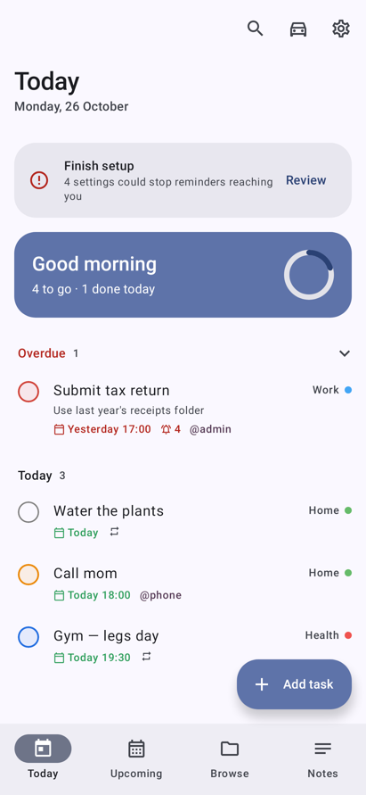
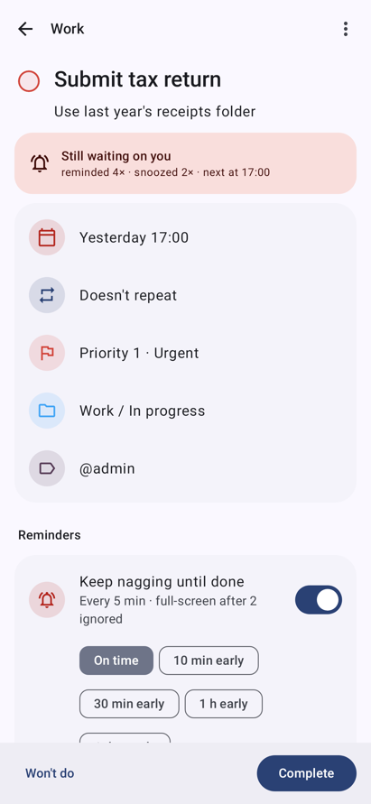
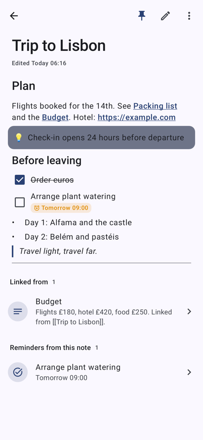
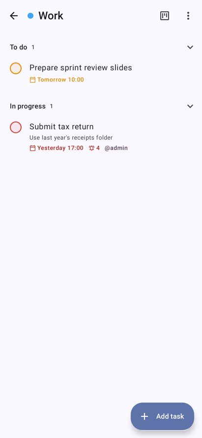
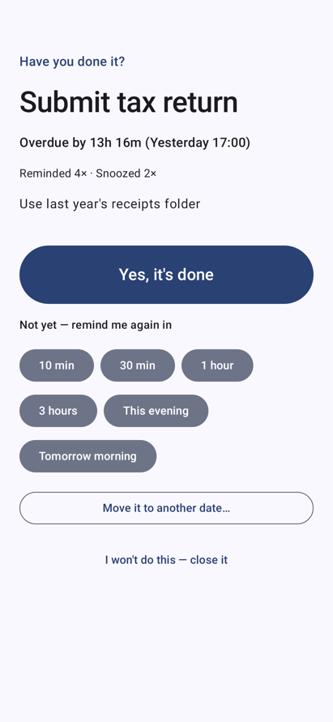
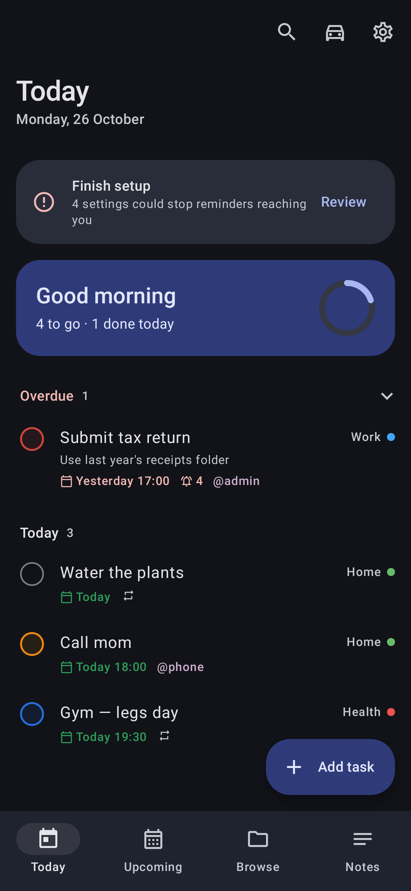

# Permatasks

A private, offline task manager and notebook for Android whose reminders **keep coming back until you actually close the task**.
Built for a Pixel 8 Pro (Android 14+). It's installed as an APK, with no Play Store, no account and no cloud.

<p>
  
  
</p>

## Features

### Nagging that doesn't give up
- **A task stays open until you answer.** A task with a date or trigger keeps reminding you until you choose one of:
  - **Done**
  - **Snooze**
  - **Move to another date**
  - **Skip this time** (repeating tasks)
  - **Won't do**
- **Swiping doesn't count.** If you swipe the notification away, it comes straight back, silently.
- **It escalates per priority (configurable).** P1 re-nags every 5 minutes. After 2 ignored reminders it takes over the screen like an alarm clock, with a looping alarm sound.
- **It follows Bedtime mode / Do Not Disturb.** Reminders wait while it's on and all come back when it ends. You can also set extra quiet hours, and choose to let P1 break through.
- **Reliable timing.** It uses exact alarms (not delayed by Doze) and re-arms them after a reboot, an app update or a time-zone change. A background safety check runs every 4 hours.
- **It keeps score.** Reminders show how often you've been reminded and snoozed.

### Tasks (Todoist-level, including Todoist's paid features)
- **Quick add in plain English:**
  - `Call mom tomorrow 6pm p1 #Family @phone`
  - `Stand-up every weekday 9:30am`
  - `Water plants every! 3 days`
  - `Dentist 3 nov`
- **Organising:** projects with sections, sub-tasks, labels, priorities P1–P4, dated or timed due dates, and "start reminding early".
- **Repeats:** daily, weekdays, chosen days, every N days/weeks/months/years, or counted from completion.
- **Views:**
  - **Today:** overdue, triggered and today's tasks, plus a progress ring.
  - **Upcoming:** a list or a month calendar that also shows your phone's calendar events.
  - **Projects:** a list or a **Kanban board**.
  - **Filters:** saved queries such as `(today | overdue) & p1 & !#Work`, plus labels.
  - **Other:** search, a completed log, a per-task activity history, and productivity stats (streaks, last 14 days).
- **Gestures:** swipe right to complete (with Undo) or swipe left to reschedule.

### Context triggers
- **Location:** remind when you arrive at or leave a saved place. Uses Google Play Services geofencing; places are found by address search or your current location.
- **Bluetooth:** remind when a device connects, e.g. when you get in the car.
- **Calendar event:** the task's due time follows an event, even if the event moves.
- **Dependencies:** a task stays quiet until another task is done, then starts nagging.

### Notes (Notion/Obsidian style)
- **Blocks:** headings, text, bullets, numbered lists, quotes, callouts, code, dividers and images. You can type shortcuts like `# `, `- `, `[] `, `> `.
- **Checklists that nag:** "+ remind me" turns an item into a real task. Ticking it in either place completes both.
- **Links:** `[[Wiki links]]` between notes (missing notes are created on tap), backlinks, and a graph view.
- **Dictation:** voice dictation and voice notes, recognised on the phone.
- **Organising:** pin notes and switch between grid and list. Notes can be shared as Markdown.

### Everywhere on the phone
- A home-screen widget (tick to complete, + to add).
- A Quick Settings tile and launcher shortcuts.
- **Share → Add as task** from any app.

### Driving
- **Drive mode:** huge buttons, voice add with a spoken confirmation, and today's tasks read aloud.
- **Pick your car:** when it connects, you get a Drive mode card and a spoken summary.
- **Read-aloud reminders:** reminders are read out while Bluetooth audio is connected.

### Security & privacy
- **No internet.** The APK has **no INTERNET permission**; this is enforced in the manifest and checked by CI.
- **Encrypted storage.** The database is encrypted with SQLCipher (AES-256), and images with AES-GCM. The keys are sealed in the Android Keystore (Titan M2).
- **App lock.** A PIN plus fingerprint/face on start, with a lockout after wrong PINs and a configurable relock time.
- **Nothing leaks from the screen.** Screenshots and recent-apps previews are blocked, and task names are hidden on the lock screen.
- **No cloud backup or tracking.** Android cloud backup and device transfer are disabled. There's no analytics and no tracking.

### Encrypted backup
- **Encrypted with your passphrase.** Backups use AES-256-GCM with a key derived from a passphrase only you know (PBKDF2-SHA256, 310k iterations).
- **Saved through the system file picker.** Choose Google Drive, OneDrive or a folder; that app does the upload, so Permatasks stays offline.
- **Automatic.** A daily backup overwrites the same file. You can also export a one-off backup.
- **Restore** works on a new phone with only the backup file and the passphrase.

## Install

1. **Signing secrets** (one time): add the four values from your signing-key file under
   *GitHub → Settings → Secrets and variables → Actions*: `PERMATASKS_KEY_ALIAS`, `PERMATASKS_KEYSTORE_PASSWORD`,
   `PERMATASKS_KEY_PASSWORD` and `PERMATASKS_KEYSTORE_BASE64`. Every build is then signed with your key, so updates install over the top without losing data.
2. **Download the APK:** *Actions → Build APK → latest run → Artifacts → permatasks-apk*. Pushing a tag like `v1.0.0` also creates a Release.
3. **Install it:** open the APK on the phone and allow "install unknown apps" for your browser or Files app.
4. **Set it up:** go through the intro, choose a PIN and enable fingerprint/face, then tap **Finish setup → Fix** for each item.
5. **Optional:**
   - Add the widget and the Quick Settings tile.
   - Set your car under Settings → Driving.
   - Set up the encrypted backup under Settings → Backup.

## Development

```bash
./gradlew :app:testDebugUnitTest   # 48 tests: parser, filters, nag engine, encryption, + screenshots in app/build/screenshots
./gradlew :app:assembleRelease     # app/build/outputs/apk/release/app-release.apk
```

Built with Kotlin, Jetpack Compose (Material 3), Room + SQLCipher, WorkManager, Glance, AlarmManager and Play Services geofencing. minSdk 34, targetSdk 36.
